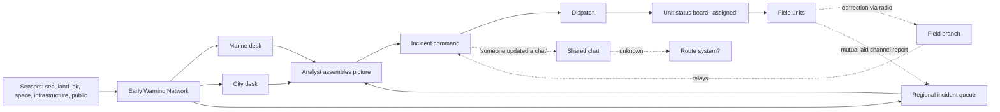

# Project Titan Watch — Shared Incident Understanding for Regional Kaiju Response

> **BRD-2026-Q4-TITAN-001** | Status: draft | Version: 0.1.0 | Last Updated: 2026-10-13
>
> Facilitator dry run. Stakeholder answers are simulated from `docs/pre-prototype` D01–D11 and the DT synthesis at `.copilot-tracking/dt/apex-titan-watch/`. Govern phase not executed; no approvals exist.

## Executive Summary

Regional response centers protecting the US and Canadian West Coast receive more kaiju-related signals than any desk can read, yet incident command still spends the first minutes of an escalation rebuilding the same story from fragments (D01). The early warning network collects feeds; it does not make them mean the same thing (D01 01:34).

Discovery reframed the original request — "bring all available data together visually" — into a business problem about meaning that survives speed: which kind of "current" a fact is, what silence means, whether a commitment is real, whether a summary is still contested, what changed and who knows it, and where weak observation hides people at risk (DT problem-definition).

This BRD states solution-agnostic business requirements for the first increment, time-boxed to the June 2030 steering review (~12 working weeks, D10). The increment must both support a funding decision (BG-006) and produce valid workflow learning (BG-007); this tension is recorded rather than resolved (ASM-004, R-001).

Key decisions: automated dispatch, live integrations, a single combined confidence score, and the "Clipzilla" mascot are Won't-this-time. Command authority stays with people (BR-001).

Primary success metric: time from escalation to an agreed incident picture in replay workflow sessions (BG-001) — baseline not yet measured.

---

## Business Context

* Since August 2029, kaiju emerge from the Pacific without warning. Regional response centers deploy military, emergency, evacuation, and infrastructure units; more notice saves more lives (D01 Background).
* The Pacific Kaiju Early Warning Network combines sea, land, air, space, and civilian-infrastructure observations and a kaiju registry. It was "assembled quickly from systems designed for weather, shipping, seismic monitoring, defense, utilities, and transportation" (D05).
* Current state: multiple analysts manually assemble signals; dispatch runs ~8 tools including an untrusted shift spreadsheet (D02); field corrections travel field → branch → command → chat (D06).
* External drivers: a June 2030 steering review decides whether a funded integration program proceeds (D09); budget may cover one artifact (D01 06:08).

---

## Stakeholders

Mendelow Power/Interest classification (see `requirements-author/references/_shared/stakeholder-analysis.md`).

| Stakeholder | Role | Power | Interest | Quadrant | Engagement strategy | Source |
|---|---|---|---|---|---|---|
| Bontle Mokgatle | Business sponsor; decision owner | High | High | Manage closely | Accountable for BRD approval; weekly review | D09, D10 |
| Steering group / agency executives | Funding decision | High | Medium (not interviewed) | Keep satisfied | Interview at least one before Govern (OQ-006) | D09 |
| Frans Vasala | Incident command rep | High | High | Manage closely | Co-author BG-001, BR-001; review all FRs | D01, D03 |
| Bratislav Tomic | Product owner (Apex) | High | High | Manage closely | BRD owner | D10, D11 |
| Sabien Arink | Dispatch operations rep | Medium | High | Keep informed → consult closely | Validate FR-007/008/009 | D02, D04 |
| Amalia Cardoso | Data & comms operations rep | Medium | High | Keep informed → consult closely | Validate FR-002–006, BR-005 | D05, D10 |
| John Falzon | Field responder rep | Low | High | Keep informed (elevate: highest physical consequence) | Validate FR-008–010, BR-002 | D06 |
| Ana Jaksic | Community rep | Low | High | Keep informed (elevate: consequence, single voice) | Validate FR-012, FR-016, BR-007 | D07 |
| Emilia Faria | Accessibility rep | Low | High | Keep informed (elevate) | Validate NFR-001–003, FR-013 | D08 |
| Snezhana Bozhilova | Technical lead | Medium | High | Keep informed | Approver: feasibility, CON-003 | D10, D11 |
| Reni Borici | Quality lead | Medium | High | Keep informed | Approver: AC set | D11 |
| Kadijah Batlouni | Service designer | Medium | High | Keep informed | Research validity; BG-007 | D01, D10 |
| Jakub Zawadzki | Prototype product lead | Medium | High | Keep informed | Demonstration narrative | D11 |
| Residents of low-signal communities; people needing more time/transport | Affected public | Low | High | **No direct voice — gap** | Targeted research before Govern | D07 |
| Other agencies / jurisdictions | Cross-border approvals | High (unknown) | Unknown | Hidden — monitor | Identify contact (OQ-004) | D04, D06 |
| Legal / compliance; IT security | Hidden tier | Unknown | Unknown | Hidden | Name an owner (OQ-002, OQ-003) | — |

---

## Design Decisions

* **DD-001**: BRD stored at `.copilot-tracking/brd-sessions/` instead of the agent default `docs/project-planning/`, because the dry run must not modify tracked files.
* **DD-002**: "Clipzilla" mascot is not a requirement. No business goal supports it (sponsor: "None that I can defend from the interviews", D09), and FR-to-BG coverage must be 100%. Recorded as Won't-this-time.
* **DD-003**: The approved prototype boundary (D10) and kickoff composition (D11) are treated as evidence of constraints, not requirements. Bratislav: "This is not a requirements baseline" (D10).
* **DD-004**: MoSCoW time-box is Increment 1, ending at the June 2030 steering review.
* **DD-005**: KPI baselines and targets are recorded as TBD rather than inferred from anecdote; they block SMART pass until measured.
* **DD-006**: Requirements are written role-neutral ("users in role X can determine…"), not as screens, panels, maps, or buttons, to keep the BRD solution-agnostic for a from-scratch design team.

---

## Business Goals

```text
BG-001: Reduce the time incident command needs to reach an agreed picture of an escalating incident.
Priority: MUST
KPI: Minutes from escalation trigger to command stating the agreed incident picture (location, likely movement, severity, what is in motion, what is unknown) in a replay workflow session.
Baseline: TBD — anecdotal "first ten minutes" (D01 02:29); to be measured in a baseline replay session.
Target: TBD — set after baseline (proposal for discussion: ≥50% reduction).
Timeframe: Measured in workflow sessions completed before the June 2030 steering review.
Measurement source: Facilitated replay workflow sessions (observer-timed).
Owner: Incident command representative (Frans Vasala).
```

```text
BG-002: Reduce response actions taken on conditions that are no longer true.
Priority: MUST
KPI: Count of assignments or commitments made in a seeded replay after the underlying condition was corrected.
Baseline: TBD (seeded replay without intervention).
Target: TBD.
Timeframe: Before June 2030 steering review.
Measurement source: Replay workflow sessions with seeded corrections (e.g., route closure, D06).
Owner: Field responder representative (John Falzon).
```

```text
BG-003: Preserve operational continuity across shift handoff.
Priority: MUST
KPI: Percentage of seeded unacknowledged commitments and decision-relevant changes an incoming operator identifies within 5 minutes of handoff.
Baseline: TBD (D04 example: an unacknowledged team was missed).
Target: TBD.
Timeframe: Before June 2030 steering review.
Measurement source: Replay handoff sessions.
Owner: Dispatch operations representative (Sabien Arink).
```

```text
BG-004: Make evidence quality visible so decisions are not made on false certainty.
Priority: MUST
KPI: Percentage of session participants who correctly identify seeded source disagreement, stale observations, and source silence.
Baseline: TBD.
Target: TBD.
Timeframe: Before June 2030 steering review.
Measurement source: Replay sessions using the messy variant (duplicate track, late correction, 6-minute silence; D02).
Owner: Data and communications operations representative (Amalia Cardoso).
```

```text
BG-005: Ensure response prioritization reflects consequence and observation coverage rather than signal volume.
Priority: SHOULD
KPI: Percentage of participants who identify a seeded low-coverage, high-consequence community as a priority question.
Baseline: TBD (D07: resources followed volume).
Target: TBD.
Timeframe: Before June 2030 steering review.
Measurement source: Replay session with a seeded low-signal community scenario.
Owner: Community representative (Ana Jaksic).
```

```text
BG-006: Enable the June 2030 steering review to make an informed funding decision on an integration program.
Priority: MUST
KPI: Steering decision recorded (go / no-go / conditional) with the artifact's replayed/mocked status acknowledged in the minutes.
Baseline: No decision; no artifact (D09).
Target: Decision recorded at the June 2030 review.
Timeframe: June 2030 steering review.
Measurement source: Steering review minutes.
Owner: Business sponsor (Bontle Mokgatle).
```

```text
BG-007: Produce valid workflow learning from Increment 1 with representative users.
Priority: MUST
KPI: Number of replay workflow sessions run with representatives of command, dispatch, data ops, field, and at least one assistive-technology user; number of recorded hypotheses tested.
Baseline: 0 sessions (D11).
Target: TBD (proposal: ≥1 session per role plus ≥1 assistive-technology session).
Timeframe: Before June 2030 steering review.
Measurement source: Test plan and session log (quality lead).
Owner: Service designer (Kadijah Batlouni) with Quality lead (Reni Borici).
```

**SMART Evaluation** (assessed at Define→Govern gate):

- [x] **S**pecific
- [ ] **M**easurable — baselines/targets TBD for BG-001–005, BG-007
- [ ] **A**chievable — cannot judge without targets
- [x] **R**elevant
- [x] **T**ime-bound

**Status**: deferred

### Outcome Hypothesis Handoff Provenance

Not applicable — no `OUTCOME_HYPOTHESIS_TO_BRD_HANDOFF_V1` payload was supplied.

---

## Business Rules

* **BR-001**: Decision authority for incident response remains with incident command; information support must not present a decision or recommendation as authoritative.
  Category: Operational. Rationale: "The system should not make the decision for me" (D01 06:25; D03). Enforceability: Mandatory. Enforcing FRs: FR-005, FR-006.
* **BR-002**: A field unit leader may refuse an unsafe route or report inability to perform a task; this is part of the control loop, not insubordination.
  Category: Operational. Rationale: D06. Enforceability: Mandatory. Enforcing FRs: FR-008, FR-010.
* **BR-003**: Radio, paper, and handing a role to another person must remain viable when information support fails.
  Category: Operational. Rationale: D04. Enforceability: Mandatory. Enforcing FRs: FR-015.
* **BR-004**: Absence of data must never be represented or communicated as "all clear."
  Category: Policy. Rationale: D02, D05, D07. Enforceability: Mandatory. Enforcing FRs: FR-003.
* **BR-005**: Every derived value (threat condition, kaiju identity, confidence) must have a documented meaning and an accountable person or source.
  Category: Policy. Rationale: "Every derived value as a transformation that needs an accountable meaning" (D05 researcher note). Enforceability: Mandatory. Enforcing FRs: FR-004, FR-005.
* **BR-006**: Any demonstration or test artifact must state plainly that data is replayed and connections are mocked, and must distinguish a simulated effect from a real-world action.
  Category: Policy. Rationale: D09 non-negotiable; D10; D11 (Reni test oracle). Enforceability: Mandatory. Enforcing FRs: (none) — enforced in test/demonstration governance (OQ-009).
* **BR-007**: Public or social signal volume must not be treated as a neutral measure of impact or need.
  Category: Policy. Rationale: D07. Enforceability: Mandatory. Enforcing FRs: FR-012.

---

## Functional Requirements

MoSCoW time-box: Increment 1 (through June 2030 steering review). Must = 9 of 17 (53%).

| ID | Requirement | Actor | Trigger | Expected outcome | Priority | AC | BG | Source |
|---|---|---|---|---|---|---|---|---|
| FR-001 | Users can review, in one place, all observations from different source types (sea, land, air, space, infrastructure, public, field) that are associated with the same incident. | Command, dispatch, data ops | New or updated observation | Related observations are reachable without consulting another system | Must | AC-001 | BG-001 | D01, D02 |
| FR-002 | For any item, users can determine when it was observed, when it was received, whether a person has interpreted or confirmed it, and whether the team expected to act has acknowledged it. | All roles | Viewing any item | The four meanings of "current" are distinguishable | Must | AC-002 | BG-004, BG-002 | D02, D05, D10 |
| FR-003 | When a source stops reporting or never reports an attribute, users can see that the information is unknown and which source is silent. | All roles | Source gap | Silence is shown as unknown coverage, never as absence of threat | Must | AC-003 | BG-004, BG-005 | D01, D02, D05 |
| FR-004 | Users can see when a kaiju identity or track is an association made by a source, an analyst, or an automated grouping, and can see competing associations until a named person resolves them. | Command, data ops | Possible duplicate or ambiguous track | Competing tracks are not merged silently | Should | AC-004 | BG-004 | D03, D05, D11 |
| FR-005 | Any summary threat condition is labeled as a summary, can be traced to its contributing evidence, and shows who confirmed it. | Command, all roles | Threat condition displayed or changed | Users can challenge the summary from evidence | Must | AC-005 | BG-004, BG-001 | D01, D03, D05, D10 |
| FR-006 | When sources disagree on a decision-relevant attribute, the disagreement is perceivable at the summary level. | Command | Conflicting observations | Contradictory evidence is not excluded by summarization | Must | AC-006 | BG-004, BG-001 | D01 03:14, D03, D05 |
| FR-007 | Users can review what changed since a chosen reference point (e.g., previous handoff or last review), including which changes remain unacknowledged. | Dispatch, command | Shift handoff; return from interruption | Incoming operator inherits changes, not only current state | Must | AC-007 | BG-003 | D01 03:02, D03, D04 |
| FR-008 | Users can distinguish commitment states of a response unit: assigned, received, accepted, moving, on scene, refused or unable. | Dispatch, command, field | Unit commitment changes | "Assigned" is never shown as equivalent to deployed | Must | AC-008 | BG-002, BG-003 | D02, D04, D06 |
| FR-009 | Users can see readiness factors that limit a unit's ability to act: staffing and qualification, equipment for the kaiju class, route reachability, existing commitments, and jurisdiction permission. | Dispatch, command | Considering a unit | Limiting factor is visible before reliance | Should | AC-009 | BG-002 | D02, D04, D06 |
| FR-010 | Field units can contribute corrections or contradicting evidence that are reflected in the regional understanding and attributed to their source. | Field unit leaders | Field observation differs from regional understanding | Correction reaches all roles with attribution | Must | AC-010 | BG-002 | D01, D02, D06, D10 |
| FR-011 | Users can see which roles have acknowledged a decision-relevant correction or change. | Command, dispatch | Correction issued | "Who knows it" is visible | Should | AC-011 | BG-003, BG-002 | D03, D04 |
| FR-012 | Users can see where observation coverage is weak by area or community, alongside areas with dense signals. | Command, dispatch | Assessing priorities | Low-signal communities remain visible | Should | AC-012 | BG-005 | D07, D10 |
| FR-013 | The information supports both shared orientation by a group at room distance and detailed inspection by an individual at a workstation. | Command (group), all roles (individual) | Escalation; inspection | Both contexts are supported | Should | AC-013 | BG-001, BG-007 | D01 04:34, D08, D09 |
| FR-014 | Users can review the sequence of arriving updates without being forced to shift attention, and only changes designated as decision-relevant interrupt. | Dispatch, data ops | High update volume | Users notice the right change under load | Should | AC-014 | BG-004, BG-003 | D04, D08 |
| FR-015 | Users can tell when shared information has stopped updating, is stale, or is operating in a degraded state. | All roles | Feed or service failure | Failure is never mistaken for calm | Must | AC-015 | BG-004 | D04, D11 |
| FR-016 | Users can see which populations need more time or different transport and whether evacuation messages reached them in usable form. | Command, dispatch | Evacuation planning | Reach and need are visible | Could | — (blocked: no data source, OQ-008) | BG-005 | D07 |
| FR-017 | Users can review a past decision as the information appeared at that moment, not as later reconstructed. | Command, after-action reviewers | After-action review | Decision context is preserved | Could | — | BG-007 | D02 (Frans) |

### Won't-have-this-time (not requirements; recorded so they do not silently disappear)

| Item | Why excluded now | Reconsider at | Source |
|---|---|---|---|
| Automated dispatch or commanding units directly from shared information | Users reject it; collapses acknowledgment, briefing, route confirmation, approval | After workflow sessions validate the acknowledgment loop (post-steering backlog review) | D03, D06, D11 |
| Live integrations with agency systems | Approved boundary for Increment 1 | Funded integration program (post-June) | D10 |
| Single combined confidence percentage | Mixes model behavior, source agreement, analyst confidence → "decorative precision" | When BR-005 meanings are defined | D05 |
| Validated threat-condition model or production-accuracy claims | No validated rule exists | Post-steering, with data-ops ownership | D10 |
| Replacing radio, paper, or existing unit boards | Fallback must remain (BR-003) | Not planned | D04 |
| "Clipzilla" mascot | Sponsor preference, no user need, no BG (DD-002) | Post-steering backlog review, only if core scenario is accepted | D09, D10, D11 |

---

## Non-Functional Requirements

*Organized by ISO/IEC 25010 Quality Characteristics*

### Functional Suitability

No separate NFR; correctness of derived values is governed by BR-005.

---

### Performance Efficiency

* **NFR-005**: Under a surge-load replay (duplicates, late corrections, silence), users detect a seeded decision-relevant change within a target time. Target: TBD after baseline (OQ-005). Linked BG-004. Source: D04.

---

### Compatibility

* **NFR-008**: Increment 1 coexists with the existing radio nets, incident queue, and unit-status board without requiring their replacement or duplicate data entry. Linked BG-001. Source: D01 03:37, D04.

---

### Usability

* **NFR-001**: Meaning is never conveyed by color alone; status remains understandable in grayscale and forced-colors modes through labels, ordering, and language. Source: D08, D11.
* **NFR-002**: All safety-critical tasks can be completed using only a keyboard. Source: D08, D11.
* **NFR-003**: Information remains usable at 200% magnification and with reduced-motion preferences honored. Source: D08, D11.
* **NFR-004**: Increment 1 introduces zero new mandatory manual update tasks for dispatch or field units beyond current practice. Source: D01 03:47, D04.

---

### Reliability

* **NFR-006**: When any external dependency (e.g., map imagery service, source feed) is unavailable, the remaining information still renders and the degraded dependency is identified to users. Source: D04, D11.

---

### Security

Not addressed by discovery. Classification and sanitization of sensor and military data are open (OQ-003).

---

### Maintainability

* **NFR-007**: Raw source observations are retained separately from derived interpretations, with source identity, observation time, and receipt time preserved, so transformations can be tested later. Source: D10, D11.

---

### Portability

Not addressed in Increment 1.

---

## Constraints

| ID | Constraint | Imposing source | Affected boundary | Non-negotiability | Category | Impact |
|---|---|---|---|---|---|---|
| CON-001 | Increment 1 must be ready for the June 2030 steering review (~12 working weeks incl. review and rehearsal). | Business sponsor / steering calendar | Timeline | Review date fixed by steering group | Schedule | Delivery |
| CON-002 | Budget may fund only one artifact before June. | Business sponsor | Budget | Funding not yet approved | Financial | Delivery, design |
| CON-003 | Increment 1 uses replayed, sanitized data only; no live integration, authentication, persistence, or operational messaging. | Approved prototype boundary (sponsor, D10) | Technology, integration | Approved in writing; operational messaging would carry real-world risk | Technical / governance | Design, acceptance |
| CON-004 | Available data is limited to the sanitized replay: six registry entries, interleaved observations, one late correction, one connectivity gap. | Data ops (Amalia) | Scope of evidence | No other sanitized data offered | Operational | Acceptance — results do not generalize |
| CON-005 | No validated rule exists to convert inputs into one threat condition. | Data ops (Amalia) | Scope | Cannot be created within the time-box | Technical | Requirement (FR-005 labeling) |
| CON-006 | Registry figures (size, speed, movement) are of uneven reliability. | Early warning network data | Data | Source data cannot be corrected in Increment 1 | Technical | Requirement (provisional display) |
| CON-007 | Movement of resources across jurisdictions requires the other agency's approval. | Inter-agency / US–Canada arrangements | Operations, organization | External authority | Regulatory / organizational | Requirement (FR-009) |
| CON-008 | Operating environment includes concurrent radio traffic, surge load, fatigue, and handoffs at any hour. | Response center operations | Operations | Inherent to the mission | Operational | Design, test conditions |

---

## Process Models

Current-state information and correction flow (as described in discovery; not a target design).



Dashed edges show the slow or lossy correction path (D01, D02, D06); `-x` marks Unit Cedar's report that never reached the queue (D02).

---

## Acceptance Criteria

All criteria are evaluated in facilitated replay workflow sessions using the messy variant (D11), not the steering happy path.

* **AC-001**: Given a replay with observations from at least four source types for one incident, When a dispatcher reviews the incident, Then every associated observation is reachable without consulting another system. Covers: FR-001. Status: Not Started.
* **AC-002**: Given an observation made at T0, received at T1, and confirmed at T2, When any user inspects it, Then the user can state each of observation time, receipt time, interpretation status, and acknowledgment status correctly. Covers: FR-002. Status: Not Started.
* **AC-003**: Given a source silent for six minutes, When users assess the affected area, Then the silence is identified as unknown with the silent source named, and no participant describes the area as "all clear." Covers: FR-003. Status: Not Started.
* **AC-004**: Given two tracks that may be the same kaiju, When no named person has resolved them, Then both remain visible as competing associations with their association method. Covers: FR-004. Status: Not Started.
* **AC-005**: Given a displayed threat condition, When a user asks why it holds, Then the user reaches the contributing evidence in two steps or fewer and sees who confirmed it, and the condition is labeled as a summary. Covers: FR-005. Status: Not Started.
* **AC-006**: Given two sources that disagree on location or identity, When command views the summary, Then the disagreement is perceivable without opening detail. Covers: FR-006. Status: Not Started.
* **AC-007**: Given a seeded unacknowledged assignment at handoff, When the incoming operator reviews changes since the previous handoff, Then the operator identifies the unacknowledged item within five minutes. Covers: FR-007. Status: Not Started.
* **AC-008**: Given a unit assigned but not acknowledged, When any user reviews the unit, Then its state is distinguishable from received, accepted, moving, and on scene. Covers: FR-008. Status: Not Started.
* **AC-009**: Given a heavy team listed as available that lacks a qualified operator or is cut off by a damaged overpass, When a dispatcher considers it, Then the limiting factor is visible before commitment. Covers: FR-009. Status: Not Started.
* **AC-010**: Given a field report that contradicts the route assumption, When the report is submitted, Then the regional understanding reflects it with attribution and dispatch users can see it. Covers: FR-010. Status: Not Started.
* **AC-011**: Given a correction issued by command, When a user checks it, Then the user can see which roles have acknowledged it. Covers: FR-011. Status: Not Started.
* **AC-012**: Given a seeded community with sparse observation coverage near a dense-signal district, When participants set priorities, Then participants identify the low-coverage community as needing a question. Covers: FR-012. Status: Not Started.
* **AC-013**: Given participants at representative room distance and at a workstation, When asked for incident posture and for supporting detail respectively, Then both tasks are completed successfully. Covers: FR-013. Status: Not Started.
* **AC-014**: Given a burst of at least 20 updates in one minute, When a user reviews arrivals, Then the user can review them in order without forced focus changes and is interrupted only by designated decision-relevant changes. Covers: FR-014. Status: Not Started.
* **AC-015**: Given a feed that stops updating, When users look at shared information, Then they can tell it is stale within a target time (TBD, OQ-005). Covers: FR-015. Status: Not Started.

---

## Traceability Matrix

### FR-to-AC Coverage

| FR | AC |
|---|---|
| FR-001 | AC-001 |
| FR-002 | AC-002 |
| FR-003 | AC-003 |
| FR-004 | AC-004 |
| FR-005 | AC-005 |
| FR-006 | AC-006 |
| FR-007 | AC-007 |
| FR-008 | AC-008 |
| FR-009 | AC-009 |
| FR-010 | AC-010 |
| FR-011 | AC-011 |
| FR-012 | AC-012 |
| FR-013 | AC-013 |
| FR-014 | AC-014 |
| FR-015 | AC-015 |
| FR-016 | (none — blocked by OQ-008) |
| FR-017 | (none) |

Coverage: 15 / 17 = **88.2%** (threshold 80.0%).

### FR-to-BG Alignment

| FR | BG |
|---|---|
| FR-001 | BG-001 |
| FR-002 | BG-004, BG-002 |
| FR-003 | BG-004, BG-005 |
| FR-004 | BG-004 |
| FR-005 | BG-004, BG-001 |
| FR-006 | BG-004, BG-001 |
| FR-007 | BG-003 |
| FR-008 | BG-002, BG-003 |
| FR-009 | BG-002 |
| FR-010 | BG-002 |
| FR-011 | BG-003, BG-002 |
| FR-012 | BG-005 |
| FR-013 | BG-001, BG-007 |
| FR-014 | BG-004, BG-003 |
| FR-015 | BG-004 |
| FR-016 | BG-005 |
| FR-017 | BG-007 |

Coverage: 17 / 17 = **100.0%**. BG-006 has no FR (it is satisfied by the increment as a whole and steering governance).

### BR-to-FR Enforcement

| BR | Enforcing FR |
|---|---|
| BR-001 | FR-005, FR-006 |
| BR-002 | FR-008, FR-010 |
| BR-003 | FR-015 |
| BR-004 | FR-003 |
| BR-005 | FR-004, FR-005 |
| BR-006 | (none — enforced through test and demonstration governance, OQ-009) |
| BR-007 | FR-012 |

---

## Risks and Assumptions

### Key Assumptions

| ID | Assumption | Evidence status | Impact if false | Mitigation | Source |
|---|---|---|---|---|---|
| ASM-001 | Role representatives speak for their roles | Untested | Requirements reflect four individuals | Session with shift operators incl. night shift | BRD discovery (D01–D06) |
| ASM-002 | Escalation reconstruction costs ~10 minutes | Partially supported (one anecdote) | BG-001 target mis-set | Baseline replay | D01 02:29 |
| ASM-003 | The sanitized replay contains the failure modes that matter | Partially supported | Learning does not generalize | Add seeded community and handoff scenarios | D02, D05, D10 |
| ASM-004 | One artifact can serve funding and learning | Contested | Either goal fails | Separate happy-path and messy-variant runs (D11) | D09, D10, D11 |
| ASM-005 | Field units can contribute corrections without added burden | Untested | FR-010 conflicts with NFR-004 | Field-condition test | D01, D04, D06 |
| ASM-006 | Command center is the right first vantage point | Contested | Optimizes what command already sees | Include community and field sessions | D07, D09, D11 |
| ASM-007 | Steering group values seeing an end-to-end scenario | Untested (via sponsor only) | BG-006 misses | Interview one steering member | D09 |
| ASM-008 | Community and accessibility needs are adequately represented by one interview each | Untested | FR-012, FR-013, NFR-001–003 incomplete | Targeted research | D07, D08 |

### Risk Register

| ID | Risk | Probability | Impact | Mitigation |
|---|---|---|---|---|
| R-001 | A polished, smooth artifact is read as a live, validated system | High | High | BR-006; label replay/mock; messy-variant sessions (D10, D11) |
| R-002 | Viewers learn the wrong mental model of dispatch (button = unit moved) | Medium | High | Won't: direct dispatch; test oracle (D11) |
| R-003 | Shared summary creates shared confidence in the wrong thing | Medium | High | FR-005, FR-006 (D03) |
| R-004 | Polish hardens an untested information hierarchy before users challenge it | High | Medium | Early sessions incl. assistive-technology users (D08) |
| R-005 | Happy path used as the only acceptance evidence | Medium | High | All ACs run on messy variant (D11 Reni) |
| R-006 | Low-signal communities remain invisible because no community member was consulted | Medium | High | Targeted research before Govern (D07) |
| R-007 | Sponsor preferences consume schedule (e.g., mascot) | Low | Low | DD-002; Won't list |

---

## Open Questions

| ID | Question or gap | Why it matters | Owner | Target date | Status | Rationale for deferral | Target phase | Source |
|---|---|---|---|---|---|---|---|---|
| OQ-001 | Who is the primary user: command, dispatch, data ops, or the shared team? | Determines FR-013 priority and test design | Product owner | 2030-03-15 | Open | — | — | D01 |
| OQ-002 | Who is the legal/compliance approver? | Sign-off authority unnamed | Business sponsor | 2030-03-08 | Open | — | — | BRD discovery |
| OQ-003 | What security classification applies to sensor and military data, even sanitized? | Security NFRs absent | Technical lead | 2030-03-15 | Open | — | — | BRD discovery |
| OQ-004 | Which other agencies/jurisdictions must approve resource movement, and who is the contact? | CON-007, FR-009 | Dispatch rep | 2030-03-22 | Open | — | — | D04, D06 |
| OQ-005 | What are the baselines and targets for BG-001–005, BG-007, NFR-005, AC-015? | SMART goals cannot pass | Quality lead | 2030-03-29 | Open | — | — | DD-005 |
| OQ-006 | What criteria will the steering group use? | BG-006 rests on sponsor's view | Business sponsor | 2030-03-22 | Open | — | — | D09 |
| OQ-007 | Does resource coordination belong in Increment 1? | Scope of FR-008/009 | Product owner | 2030-03-15 | Open | — | — | D01 |
| OQ-008 | Is there any data source for evacuation-message reach or populations needing more time? | FR-016 has no AC | Community rep | — | Deferred | No data source exists in Increment 1 | Future-Release | D07 |
| OQ-009 | Who governs demonstration labeling (BR-006) and the test oracle? | BR-006 has no FR | Quality lead | 2030-03-15 | Open | — | — | D11 |

---

## Glossary

* **Kaiju**: Giant creature emerging from the Pacific; may travel underwater, surface briefly, or disrupt electronics (D01).
* **Pacific Kaiju Early Warning Network**: Joint US–Canada network combining sea, land, air, space, and civilian infrastructure observations (D01).
* **Registry**: Catalog of known kaiju with estimated size, speed, and movement; figures of uneven reliability (D05).
* **Threat condition**: Shared shorthand for incident posture (e.g., "condition four"); a summary, not authority (D03).
* **"Current" (four meanings)**: latest message received; latest observation made; latest interpretation agreed by a person; latest state acknowledged by the team expected to act (D02).
* **Commitment states**: assigned, received, accepted, moving, on scene, refused/unable (D04, D06).
* **Silence**: Absence of data from a source; means nothing by itself (D05).
* **Replay**: Sanitized recorded incident data used instead of live feeds (D02, D10).
* **Clipzilla**: Communications-team nickname for the classifier; proposed mascot (D09). Not a requirement.

---

## Sign-Off

### Approval Checklist

* Business Sponsor: Bontle Mokgatle — not requested (dry run).
* Product Owner: Bratislav Tomic — not requested.
* Technical Lead: Snezhana Bozhilova — not requested.
* Quality Lead: Reni Borici — not requested.
* Legal/Compliance: TBD (OQ-002).

Approval date: N/A — Govern phase not executed.

### Waivers

None.

### Handoff Readiness

Not evaluated — Govern skipped. No `BRD_TO_PRD_HANDOFF_V1` produced.

---

## Disclaimer

> [!CAUTION]
> **Disclaimer:** This agent is an assistive tool only. It does not provide business approval, regulatory compliance validation, or executive sign-off and does not replace business analysts, stakeholder representatives, compliance teams, or other qualified human reviewers. The output consists of suggested business requirements, objectives, and scope definitions to support a user's own business analysis and decision-making. All Business Requirements Documents, business objectives, stakeholder analysis, and requirement traceability generated by this tool must be independently reviewed and validated by appropriate business and compliance reviewers before adoption. Outputs from this tool do not constitute business approval, requirements sign-off, or stakeholder commitment.

---

## Document Metadata

* Template Version: 1.0.0.
* Canonical Template: `requirements-author/templates/brd/brd-full.md`.
* License: CC-BY 4.0 (Microsoft HVE-Core).
* Attribution: Microsoft HVE-Core Team.
